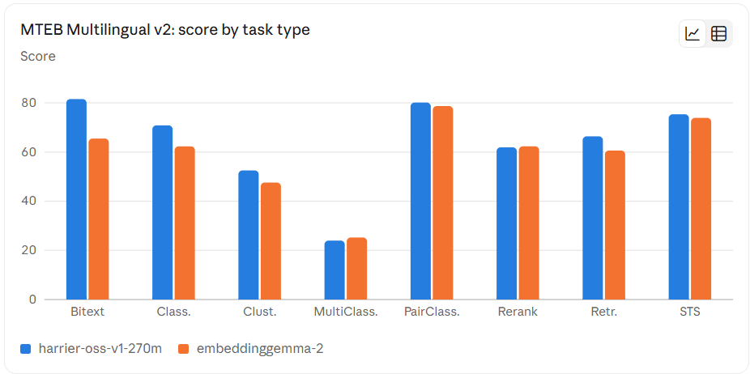

# Decisions Log

Every component choice gets an entry here before any code is written. Each entry names what was rejected and why, and states a falsification
condition so the decision can be revisited honestly later.

---

## [2026-10-22] Corpus choice: NHTSA recall communications + DoD issuances + FAA Advisory Circulars

**Chose:** A three-source public-domain technical corpus —
NHTSA recall-communication documents (manufacturer notification/owner letters,
quarterly reports, indexed via the ODI flat files), publicly releasable DoD
issuances (manuals preferred over instructions/directives), and FAA Advisory
Circulars (via the National Transportation Library's ROSA P repository, which
turned out to be a better crawl target than faa.gov itself — see the Increment 0
note below).

All three sit in the automotive/aerospace/defense technical-documentation space:
dense procedural text, part numbers and component identifiers, affected-item
tables, repair/remedy steps, cross-references, and (for DoD manuals especially)
diagrams — the structural properties that break naive chunk-and-embed RAG and
are therefore worth measuring. FAA Advisory Circulars are specification-dense and
table-heavy, which teaches the system more than policy prose does.

**Rejected:**
- *arXiv papers* — trivially easy to bulk-download and legally unambiguous, but
  prose-shaped. They don't exercise tables, part numbers, procedures, or
  cross-references, which is the entire point of choosing a document-heavy
  domain. A corpus that's easy to retrieve against teaches nothing about
  document intelligence.
- *OEM service manuals* — the most structurally interesting option (exactly the
  kind of procedural, diagram-heavy content the author's automotive-adjacent
  domain knowledge could verify answers against) but copyrighted by the
  manufacturer. This repo ships to a public URL, so anything not legally
  redistributable is disqualified regardless of how good it is for retrieval.
- *NHTSA Technical Service Bulletins* — hosted by NHTSA's Office of Defects
  Investigation, which makes them *look* like government records, but they are
  authored and copyrighted by OEMs. Republishing them in a public repo is a
  copyright risk; TSB content, if wanted at all, is metadata/index records only,
  never the bulletin PDFs. See `docs/corpus-requirements.md`.

**Trade-off accepted:** Format heterogeneity across three agencies and many
manufacturers means more crawler edge cases than a single uniform source would
have (confirmed while building `src/corpus/fetch_corpus.py`: esd.whs.mil
blocks plain HTTP clients with a 403, even with browser-style headers, so the
DoD source degrades to zero documents in this environment and must be made up
from NHTSA). We accept that cost because format heterogeneity is also the
realistic case, and most portfolio RAG projects avoid it by picking one clean
source.

**Open issue carried forward (not yet resolved — flagging rather than
assuming):** researching `src/corpus/fetch_corpus.py` surfaced that the actual
PDF documents available from NHTSA's recall-communications flat files (owner
notification letters, manufacturer notification letters, quarterly Part 573.6
reports) are *manufacturer-authored*, filed under 49 CFR Part 573's
mandatory-disclosure requirement — the same fact pattern flagged above for
TSBs ("hosted by a federal agency" is not "authored by a federal agency, hence
public domain"). The fetcher records these with `licence:
needs_review-manufacturer_authored_mandatory_disclosure` rather than
`public_domain`, and no NHTSA document should be treated as safe to publish
until this is resolved (e.g., by confirming a specific disclosure regulation
grants redistribution rights, or by replacing/supplementing NHTSA with a
higher share of DoD/FAA documents, which are unambiguous US-government works).

**How we'd know this was wrong:** if, once golden questions are drafted against
these documents, verification keeps requiring outside domain knowledge the
author doesn't have (rather than NHTSA/DoD/FAA domain familiarity), or if the
NHTSA licence question above is resolved against redistribution and the corpus
has to be rebuilt around DoD/FAA alone.

---

## [2026-10-22] Ground-truth granularity: document location, not chunk ID

**Chose:** `golden/questions.jsonl` records ground truth as
`{doc_id, page, region}` — a location in the *source document* — never a chunk
ID from any particular chunking strategy.

**Rejected:** Recording ground truth as a chunk ID (e.g., "chunk_0042") from
the Increment-0 naive baseline's fixed-512-token chunker. This was rejected
because Increment 1 explicitly changes chunking (hybrid retrieval, reranking,
query transforms), and a chunk-ID ground truth would silently redefine
"correct" every time the chunker changes. Worse, it makes the eval set
measure the chunker against itself: if a question's answer and its "correct"
chunk were both derived from the same chunking pass, retrieval evaluation
degenerates into checking whether the current chunker agrees with a past run
of itself, not whether it found the right information.

**Trade-off accepted:** Location-based ground truth is more expensive to
score — recall/precision/MRR/NDCG need a page-and-region-to-chunk mapping
step (checking whether a retrieved chunk's span overlaps the recorded
location) instead of a trivial ID-equality check. We accept the extra
scoring-harness complexity because it is a one-time cost paid in
`src/evaluate/`, whereas a chunk-ID ground truth would need to be *regenerated* at every chunking change across all ~70 questions — a recurring cost that compounds across Increment 1's multiple
retrieval techniques.

**How we'd know this was wrong:** if the location-to-chunk overlap scoring
logic turns out to be ambiguous often enough (e.g., a table answer spans a
region no single reasonable chunk boundary fully contains) that the human
author has to adjudicate individual eval runs by hand rather than trusting
the harness — that would mean the granularity chosen is finer than the
scoring method can cleanly support.

---

## [2026-10-22] Target corpus size: 200-500 documents, not ~20

**Chose:** A minimum of 200 documents (target 200-500), sourced per
`docs/corpus-requirements.md`'s per-source breakdown (NHTSA 50-70, DoD 20-30,
FAA 20-30 = 90-130 planned), topped up from the richest source (NHTSA) if the
combined total falls short of 200.

**Rejected:** A small pilot-sized corpus (~20 documents), which would be far
faster to acquire, manifest, and iterate on. Rejected because retrieval
problems are invisible below roughly 100 documents — with only 20 documents,
dense retrieval, filtering, and reranking all look like they work regardless
of whether the underlying technique is sound, simply because there isn't
enough distractor content for a bad retriever to rank a wrong document above
the right one. Every Increment-1 measurement (the project's entire thesis —
measured deltas against a recorded baseline) would be noise at that scale.

**Trade-off accepted:** A 200+ document corpus takes materially longer to
acquire, verify (SHA256, `%PDF` magic bytes, page-count sanity, licence
determination per document), and manifest than a 20-document pilot would, and
makes manual review of the full corpus impractical — the acceptance checks in
`docs/corpus-requirements.md` (format diversity, no TSB bulletins present,
page-count distribution) exist specifically because the corpus is too large
to eyeball exhaustively.

**How we'd know this was wrong:** if, even at 200+ documents, recall@5 is
saturated (near 1.0) for the naive baseline — meaning the corpus isn't
actually hard enough to discriminate between retrieval techniques in
Increment 1 — the target should move toward 500 and/or toward documents with
denser cross-references between them, not stay at 200.

---

## [2026-10-24] Local Pass-2 review tool: Vite+React+TS at frontend/admin/, iframe PDF viewer, direct Node fs persistence

**Chose:** A third interchangeable Pass-2 interface at `frontend/admin/`
(Vite + React + TypeScript), placed inside `frontend/` as its own sub-app
because it's intended to seed a later admin app rather than stay a
throwaway script. PDFs are served via a Vite `configureServer` middleware
(one `npm run dev`, no second process); page-jump uses the browser's native
PDF viewer, `<iframe src="/pdfs/:docId#page=N">`; decisions persist via
direct Node `fs` JSONL read/write in `server/goldenStore.ts`, reimplementing
`src/eval/review_golden.py`'s `save_jsonl`/`next_question_id`/accept-
reject-flag logic in TypeScript rather than shelling out to Python.

**Rejected:**
- *A separate Express/Node static server* — an extra process to remember to
  start defeats the point of a faster workflow.
- *react-pdf / pdfjs-dist for v1* — a real dependency bought nothing the
  actual ask needed; the requirement was "open to the right page," not
  highlight the evidence text on it. `PdfPane`'s prop interface (`docId`,
  `page`) is kept narrow so swapping in `react-pdf` later for highlighting
  doesn't ripple into the rest of the app.
- *Shelling out to `review_golden.py`'s Python functions per request* —
  cross-process latency, Windows subprocess quoting, and encoding risk
  (the project already had to work around a `utf-8-sig` BOM once) for only
  ~40 lines of logic to port.
- *Reusing the pre-built `corpus/.cache/review_export.json` as a static
  data source* — it was built for the offline/Artifact reviewer and can go
  stale if `candidates.jsonl` changes without someone remembering to
  re-run the export script. The new server derives the same
  `{doc_id, page, region, excerpt}` shape live from `candidates.jsonl` +
  `corpus/.cache/page_catalog.jsonl` on every `/api/candidates` request
  instead.

**Trade-off accepted:** Three independent implementations of the same JSONL
read/write/next-id logic now exist (Python in `review_golden.py`, and
TypeScript in `frontend/admin/server/goldenStore.ts`) and must be kept in
schema agreement by convention — documented in `frontend/admin/README.md` —
not by shared code. Re-editing an already-accepted candidate patches the
matching `questions.jsonl` row in place by its stored `question_id`, rather
than minting a new `qNNN` or leaving a stale duplicate.

**How we'd know this was wrong:** if the TypeScript and Python
implementations drift (e.g. differing `notes` formatting on accepted
questions, or a reject-reason field renamed in one but not the other) and
corrupt `golden/questions.jsonl`'s consistency across the three interfaces;
or if `frontend/admin/` never actually becomes the seed of an admin app,
in which case it should have been a disposable `eval/` script after all.

---

## [2026-10-24] frontend/admin/ styling: Bootstrap 5.3 via Sass source customization, not utility-fighting

**Chose:** Bootstrap 5.3 as the styling framework for `frontend/admin/`,
customized through its documented Sass workflow (`src/styles/custom.scss`
overrides `$primary`, `$success`, fonts, and radii *before* importing
Bootstrap's source) rather than loading the prebuilt CSS and overriding it
with higher-specificity rules afterward. Dark mode uses Bootstrap's native
`data-bs-theme` color-mode mechanism, synced from `prefers-color-scheme` in
`src/main.tsx`, with the dark palette supplied as a `--bs-*` custom-property
override block — Bootstrap's own documented pattern, not a parallel
hand-rolled dark stylesheet. Every component was rewritten to use Bootstrap's
own classes (`.btn`, `.badge`, `.card`, `.list-group`, `.progress`) instead
of bespoke ones of the same name, specifically to avoid the class-name
collisions (`.btn`, `.badge`, `.progress` all being real Bootstrap
components) that a "just add the CSS file" approach would have produced.

**Rejected:** `sass-embedded` for the Sass compiler — it spawns a native
Dart Sass subprocess, which failed with `spawn UNKNOWN` in this sandboxed
dev environment. Switched to the plain `sass` package (pure JS, no
subprocess) instead.

**Trade-off accepted:** A real build-time dependency (Sass) where there was
none before, and a compiled-CSS step between source and what the browser
loads, in exchange for customization that doesn't fight Bootstrap's own
cascade.

**How we'd know this was wrong:** if `custom.scss`'s variable overrides
drift out of sync with a future Bootstrap upgrade (a renamed variable
silently falling back to Bootstrap's default instead of erroring), or if
`sass`'s slower pure-JS compile becomes a noticeable `npm run dev` startup
cost worth trading back for `sass-embedded` once whatever blocked its
subprocess spawn is understood.

## [2026-10-27] Document Parser Choice, Database Choice, Index Choice.

**Document Parser Selection:**

I selected Docling because it is open source and runs on both CPU and CUDA.
It uses a DocLayNet-trained layout model and TableFormer for table structure
recognition, and it supports additional model integrations
(https://docling-project.github.io/docling/usage/model_catalog/#image-classifier-picture-classifier).
Output formats include Markdown, JSON, and DoclingDocument.

Published comparisons consistently rank Docling above Unstructured on table
structure extraction, but the available benchmarks are weak. The most
methodologically complete comparison is vendor-published for a product that
has since been discontinued; another derives its headline figure from a single
48-cell table; and the two disagree on Unstructured by 18 points. I chose
Docling based on the direction of those results plus ecosystem fit — CPU and
CUDA support, DoclingDocument output, and TableFormer for tables — and I treat
the accuracy claim as unverified until I run my own extraction evaluation.

Docling configurations I considered:

| Configuration | Models | Purpose |
|---|---|---|
| A — Standard baseline | Heron layout + RapidOCR + TableFormer Accurate + CodeFormulaV2 | Strong starting point with separately configurable stages |
| B — Higher-accuracy layout | Egret Large + RapidOCR + TableFormer Accurate + CodeFormulaV2 | Test whether the larger layout model improves difficult pages |
| C — VLM alternative | Docling VLM pipeline with Granite-Docling-258M; compare SmolDocling and GOT-OCR-2.0 | Evaluate end-to-end parsing on complex or image-heavy documents (lighter VLM option) |
| D — VLM alternative | Docling VLM pipeline with mineru2_pro (1.2B model) | Heavier VLM alternative within the Docling pipeline |

I also referred to OmniDocBench on PDFs
(https://arxiv.org/html/2412.07626v2). From that paper, my understanding of
per-task leaders (OmniDocBench v1, Dec 2024; later superseded on v1.5 by
GLM-OCR, PaddleOCR-VL, and MinerU 2.5) is:

- Layout detection — DocLayout-YOLO
- Table recognition — RapidTable
- Text recognition — PaddleOCR
- Formula recognition — Mathpix (GPT-4o and UniMERNet-B are also strong)
- Specialized VLM — GOT-OCR
- General VLM — Qwen2-VL-72B

Practical routing implied by that work:

- Scanned PDFs → OCR-based pipelines
- Complex layouts or embedded visual content → VLMs

For general document parsing, MinerU is a strong alternative: it already
includes its own layout-detection and parsing stages, and it ranks well as a
full pipeline across tables, text, and reading order.

Preferred starting point by document condition:

| Document condition | Preferred starting point |
|---|---|
| Clean vector PDF with ordinary text | Native PDF text extraction |
| Vector PDF with complex columns and tables | MinerU or another layout-aware pipeline |
| Scanned PDF with ordinary text | OCR pipeline using PaddleOCR, or a complete parser |
| Scanned PDF with dense tables | Layout detection + OCR / table recognition |
| Complex diagrams with meaningful visual relationships | Pipeline plus targeted VLM analysis |
| Poor-quality scans or unusual layouts | Compare pipeline and VLM outputs on representative pages |
| Formula-heavy technical papers | Parser with formula support; specialized formula recognition where needed |

I am going with Docling. There is no single best pipeline or VLM for every
document type, and building a custom multi-model parsing stack would mean
pipeline construction, output normalization across models, evaluation harness
work, and custom routing. Docling already provides a ready-to-use document
parser pipeline, so I am accepting that trade-off to avoid that complexity.

**Database Selection:**

I evaluated **pgvector**, **Qdrant**, **Milvus**, and **Neo4j**. I selected
**pgvector**.

**Chose: pgvector (Postgres + vector extension).** It is open source, easy to
deploy, and integrates cleanly with Python. One database holds tenant metadata,
business entities as relational SQL rows, and vectors together — no cross-DB
join, sync, or dual-write stabilisation. Backup, restore, and migration stay
ordinary Postgres operations. The vector index is derived and disposable; the
canonical document store stays separate. That is why starting on pgvector is
cheap to reverse if measurement later forces a move.

**Trade-offs I accept with pgvector.**
- Postgres `tsvector` is **not BM25**: it has no IDF weighting, so lexical
  scores must be fused myself (typically with RRF). This corpus is full of part
  numbers and identifiers where lexical search matters. That is the real
  weakness, and it lands in Increment 1.
- pgvector applies filters **after** the HNSW graph walk, so a selective filter
  can discard every approximate candidate and hurt recall. I will filter by
  `doc_id`, `chunk_type`, and `index_version_id`, and I will measure that
  behaviour on this corpus.

**Rejected for now: Qdrant and Milvus.** Both are strong purpose-built vector
stores. Relative to pgvector they typically offer faster specialised HNSW
paths, first-class hybrid / BM25-style lexical search, and mature filtered
retrieval. I did **not** choose them for Increment 0 because a dedicated vector
DB plus a separate relational store is over-engineering for ~200 documents: no
single-DB ACID boundary across metadata and vectors, and I would need two
systems (relational + vector) with cross-DB consistency. I will re-evaluate
Qdrant/Milvus in **Increment 1** on index build time, query latency, BM25 /
hybrid quality on identifier queries, and filtered-recall — and move only if
measurement beats pgvector enough to justify the second service.

**Deferred: Neo4j.** I am not selecting Neo4j yet. I will first measure
multi-hop question answering with hybrid RAG and contextual / layout-aware
chunking. Graph retrieval is justified only if that path fails the multi-hop
slice of the eval set.

**Indexing Selection:**

I am choosing **HNSW** over **IVFFlat** in pgvector.

**Why not IVFFlat as the primary index.** IVFFlat partitions vectors into
`lists` clusters via k-means at build time, then at query time scans only the
nearest `probes` lists. That makes builds fast and memory light, but the
centroids are fixed when the index is created. As the corpus grows — especially
when new embedding clusters appear — those centroids no longer represent the
data well, so recall drops until a rebuild (`REINDEX`) recomputes them. HNSW
has no training step and can be created on an empty table; inserts grow the
graph without that centroid-staleness failure mode.

**Published / measured comparisons I am using as priors** (my own corpus
numbers will replace these once I measure on the Increment 0 index):

| Property | IVFFlat | HNSW |
|---|---|---|
| Index build (AWS blog, ~58k rows, pgvector 0.5 → 0.6) | ~15 s | ~81 s → ~30 s after 0.6 build optimisations |
| Query latency (same AWS setup) | ~2.4 ms | ~1.5 ms (vs ~650 ms sequential scan) |
| Build vs query trade (independent 100k-vector measure) | ~5 s build; strong recall when data matches the original clusters | ~67 s build; ~50% larger index; recall stays stable as new vectors arrive |
| After inserting vectors from *new* clusters (same 100k→150k measure) | Recall@10 fell from ~0.997 to **0.473** at `probes=10` until `REINDEX`; after rebuild, recall returned to ~1.0 | Grown-by-insert recall stayed within ~0.003 of a fresh HNSW build (no rebuild required) |
| Recall/latency knob | `ivfflat.probes` (more lists scanned → higher recall and latency) | `hnsw.ef_search` (wider graph search → higher recall and latency) |

Sources: AWS Database Blog on pgvector IVFFlat vs HNSW; Neon’s pgvector
guidance (HNSW has no IVF training step; slower build, more memory); and the
public 100k-vector IVFFlat-vs-HNSW measurement on new-cluster inserts.

**HNSW advantages for this project.** Higher speed–recall trade-off for online
queries; no periodic rebuild tax as I add documents across increments;
incremental inserts keep recall stable; tunable with `m` /
`ef_construction` (build quality) and `ef_search` (query recall). That fits a
corpus that will grow and an eval loop that cannot afford silent recall decay
from stale IVF centroids.

**Trade-off I accept.** HNSW takes longer to build and uses more memory than
IVFFlat. For the first bulk load I will **insert all vectors first, then
`CREATE INDEX` with HNSW** — building HNSW on an empty table and inserting into
it is substantially slower than load-then-index. I will record build time,
query p95, and recall@k for the chosen `(m, ef_construction, ef_search)` in
this log once the full corpus is indexed.

**How I'd know this was wrong:** if HNSW build time or memory becomes the
binding constraint at full corpus size while measured recall@k on IVFFlat
(with a rebuild policy) matches HNSW within tolerance — then IVFFlat with
scheduled reindex would be the better fit.

## [2026-10-28] Docker Compose Setup & Docling Implementation.
**Docker Compose setup with live code integration:**

**Chose:** A Linux dev container under `docker/dev/` (`Dockerfile` +
`docker-compose.yml`) that runs the Python stack (including Docling) outside
Windows Smart App Control.

**Why.** A fresh Windows `.venv` install of pandas **3.1.0** and current Docling
fails under Smart App Control: native extensions (e.g. pandas `interval*.pyd`)
and console `.exe` entry points are blocked at load time, so Docling cannot
import on the host. The older, already-trusted packages still work, which confirms the blocker is policy/reputation on newly downloaded binaries — not Docling itself. Running the same stack in Linux containers avoids that Windows code-integrity path.

**Layout.**
- Image: `python:3.12-slim-bookworm` with system libs Docling needs (`libgl1`,
  `libglib`, `libgomp`, etc.) and `pip install .` from `pyproject.toml` baked in.
- Bind-mount the repo root to `/workspace` so host edits appear in the container
  immediately — no image rebuild for code changes.
- Bind-mount host HuggingFace and Torch caches into `/cache/...` so model
  downloads persist across rebuilds and are shared with other projects on this
  machine.
- Container stays up with `sleep infinity`; I attach with
  `docker compose … exec dev bash` and restart with
  `docker compose … restart dev` when needed.

**Operational rules I am accepting.**
- **Code change** → no rebuild, no restart; the bind mount is enough.
- **Environment / process change** → `restart` the `dev` service (or re-exec a
  shell and restart the process inside).
- **`pyproject.toml` dependency change** → `up -d --build` so site-packages in
  the image are refreshed. Runtime mounts overwrite `/workspace` but not the
  image’s installed packages.

**Rejected for now:** Disabling Smart App Control system-wide just to run the
Windows venv — one-way on many Windows 11 installs and broader than this
project needs. Also rejected: copying AMI’s trusted `.venv312` into this repo
as a permanent dependency (cross-repo coupling, wrong package pins).

**Trade-off accepted:** Docker Desktop must be running; first build pulls models
and base layers; Linux paths differ from Windows. In exchange I get a
reproducible Docling/Python environment that is not blocked by host App Control,
with a fast edit–run loop via the volume mount.

**How I'd know this was wrong:** if Smart App Control is turned off (or an
allowlist covers `.venv`) and a clean Windows venv imports Docling reliably, the
container becomes optional overhead; or if bind-mount I/O on Windows makes
Docling/PDF workloads unusably slow compared with copying code into the image.

---

## [2026-10-28] Packaging (pyproject.toml), Postgres migrations, driver, and compose layout

**Chose:**
- **`pyproject.toml` (PEP 621)** as the single declared dependency source —
  runtime deps (`docling`, `psycopg[binary]`, `pgvector`, `alembic`, …),
  optional `dev` extras (`pytest`, `ruff`), and tool config for setuptools /
  pytest / ruff in one file. The Docker image installs with `pip install .`
  from that file; dependency bumps mean rebuild (`up -d --build`).
- **Alembic** for schema migrations, with the first revision creating the
  `vector` extension (`alembic/versions/a81c97fe7f23_create_vector_extension.py`).
  `alembic/env.py` injects `DATABASE_URL` from `src.config.settings` (built from
  `POSTGRES_*` in `.env`) so `alembic.ini` never holds live credentials or
  unexpanded `${…}` placeholders.
- **psycopg v3** (`postgresql+psycopg://…`) plus the **`pgvector`** Python
  package for the vector type, against a **`pgvector/pgvector:pg18`** container.
- **Two Compose files:** `docker/dev/docker-compose.yml` (app/dev) and
  `docker/dev/docker-compose-db.yml` (Postgres + named volume), merged at
  runtime with `--env-file .env`. Host-side tools use `localhost` and a
  published port (5433 by default, to avoid clashing with a native Windows
  Postgres on 5432); the app container overrides to `db:5432` on the compose
  network.

**Rejected:**
- *`requirements.txt` (or a parallel pin file beside `pyproject.toml`)* — a
  second list drifts from the installable project metadata and duplicates what
  Docker already consumes via `pip install .`. One TOML file is enough at this
  size.
- *Poetry / uv lockfile-first workflows* — useful later for reproducible CI
  pins; premature while the stack is still settling and Docker rebuilds are the
  install path.
- *Hand-rolled numbered SQL plus a custom runner* — at this schema size it
  would mean more files and glue to maintain by hand for no real benefit over
  Alembic's revision chain and `upgrade head`.
- *psycopg2* — legacy; psycopg v3 is the current sync driver and matches the
  SQLAlchemy URL we need for Alembic.
- *asyncpg* — there is no async data-access path elsewhere in the project yet;
  introducing one only for migrations or early storage would be speculative.
- *SQLAlchemy ORM as a required layer* — not needed until/unless I actually
  want mapped models; Alembic + psycopg is enough for extension DDL and later
  imperative migrations.
- *Folding `db` into the existing `docker-compose.yml`* — that couples the
  database lifecycle to the Docling/dev container (rebuilds, GPU overlays,
  bind-mount churn). Keeping DB in a separate compose file lets me bring
  Postgres up alone for Alembic on the host.

**Trade-off accepted:** Two compose invocations (or a short alias) instead of
one file; and host vs container Postgres hostnames must stay explicit in `.env`
/ compose overrides. Packaging-wise, floating lower bounds in `pyproject.toml`
mean rebuilds can pull newer minors until I add a lockfile. In exchange I get
one install source for local and Docker, a disposable vector-capable Postgres
that can outlive the app container, and migrations that run the same way from
Windows or from inside `doc-intel-dev`.

**What is in place now:** `pyproject.toml` owns deps and tool config;
`requirements.txt` removed; `CREATE EXTENSION vector` applied via
`alembic upgrade head`; connection settings centralized in `.env` /
`settings.DATABASE_URL`; DB volume mounted at `/var/lib/postgresql` for the
PG 18 image layout.

**How I'd know this was wrong:** if CI or teammate installs need bit-for-bit
reproducible pins that floating `>=` ranges cannot give — then add a lockfile
(uv/poetry) without abandoning `pyproject.toml` metadata; if Alembic's
migration history starts needing branching/merging that feels heavier than the
schema warrants — then a thin numbered-SQL runner would have been enough; or if
psycopg's pgvector adapter hits a rough edge that the `pgvector` Python package
does not smooth over — then reconsider asyncpg or a different access path for
vector I/O only.

**DDL of RAG eval:**
Since the project is about improvement and comparision of the improvement with the help of eval results, we need to store the improvement by recording the changes being done and resulting eval records, So we can revisit and verify and get the pattern of the run status.

For this purpose we are desing these tables:

INDEX_VERSION: INDEX_VERSION_ID (PK), DESCRIPTION (nullable), CHUNKER_ID (FK → CHUNKER, NOT NULL, idx), EMBEDDER_ID (FK → EMBEDDER, NOT NULL, idx), PARSER_ID (FK → PARSER, NOT NULL, idx), CONFIG (nullable unless INDEX_*_CONFIG is unused), CREATED_DATE (NOT NULL), CREATED_BY (NOT NULL)
INDEX_RUN: INDEX_RUN_ID (PK — add if missing), DOC_COUNT (NOT NULL), CHUNK_COUNT (NOT NULL), TIME_ELAPSED (nullable until complete), STATUS_ID (FK → STATUS, NOT NULL, idx), CREATED_DATE (NOT NULL), CREATED_BY (NOT NULL); FK INDEX_VERSION_ID (→ INDEX_VERSION, NOT NULL, idx) if each run belongs to a version
CHUNKER: CHUNKER_ID (PK), CHUNKER_NAME (NOT NULL), CHUNKER_DESCRIPTION (nullable), VERSION (NOT NULL), CREATED_DATE (NOT NULL), CREATED_BY (NOT NULL), ACTIVE (NOT NULL, default true), MODIFIED_DATE (nullable), MODIFIED_BY (nullable); UNIQUE (CHUNKER_NAME, VERSION)
PARSER_ID: PARSER_ID (PK), PARSER_NAME (NOT NULL), PARSER_DESCRIPTION (nullable), VERSION (NOT NULL), CREATED_DATE (NOT NULL), CREATED_BY (NOT NULL), ACTIVE (NOT NULL, default true), MODIFIED_DATE (nullable), MODIFIED_BY (nullable); UNIQUE (PARSER_NAME, VERSION)
EMBEDDER_ID: EMBEDDER_ID (PK), EMBEDDER_NAME (NOT NULL), EMBEDDER_DESCRIPTION (nullable), VERSION (NOT NULL), CREATED_DATE (NOT NULL), CREATED_BY (NOT NULL), ACTIVE (NOT NULL, default true), MODIFIED_DATE (nullable), MODIFIED_BY (nullable); UNIQUE (EMBEDDER_NAME, VERSION)
INDEX_PARSER_CONFIG: INDEX_VERSION_ID (FK → INDEX_VERSION, NOT NULL, idx), PARSER_ID (FK → PARSER, NOT NULL, idx), CONFIG_NAME (NOT NULL), CONFIG_VALUE (NOT NULL), DESCRIPTION (nullable), DETAILS (nullable), CREATED_DATE (NOT NULL), CREATED_BY (NOT NULL), ACTIVE (NOT NULL, default true), MODIFIED_DATE (nullable), MODIFIED_BY (nullable); PK or UNIQUE (INDEX_VERSION_ID, PARSER_ID, CONFIG_NAME); ON DELETE CASCADE with INDEX_VERSION
INDEX_CHUNKER_CONFIG: INDEX_VERSION_ID (FK → INDEX_VERSION, NOT NULL, idx), CHUNKER_ID (FK → CHUNKER, NOT NULL, idx), CONFIG_NAME (NOT NULL), CONFIG_VALUE (NOT NULL), DESCRIPTION (nullable), DETAILS (nullable), CREATED_DATE (NOT NULL), CREATED_BY (NOT NULL), ACTIVE (NOT NULL, default true), MODIFIED_DATE (nullable), MODIFIED_BY (nullable); PK or UNIQUE (INDEX_VERSION_ID, CHUNKER_ID, CONFIG_NAME); ON DELETE CASCADE with INDEX_VERSION
INDEX_EMBEDDER_CONFIG: INDEX_VERSION_ID (FK → INDEX_VERSION, NOT NULL, idx), EMBEDDER_ID (FK → EMBEDDER, NOT NULL, idx), CONFIG_NAME (NOT NULL), CONFIG_VALUE (NOT NULL), DESCRIPTION (nullable), DETAILS (nullable), CREATED_DATE (NOT NULL), CREATED_BY (NOT NULL), ACTIVE (NOT NULL, default true), MODIFIED_DATE (nullable), MODIFIED_BY (nullable); PK or UNIQUE (INDEX_VERSION_ID, EMBEDDER_ID, CONFIG_NAME); ON DELETE CASCADE with INDEX_VERSION
EVAL_RUN: EVAL_RUN_ID (PK), INDEX_VERSION_ID (FK → INDEX_VERSION, NOT NULL, idx), EVAL_RECORD_ID (FK → EVAL_RECORD, NOT NULL, idx), METRIC_VALUE (NOT NULL), QUESTION_TYPE_ID (FK → QUESTION_TYPE, NOT NULL, idx), CREATED_DATE (NOT NULL), CREATED_BY (NOT NULL), STATUS_ID (FK → STATUS, NOT NULL, idx)
EVAL_TYPE: EVAL_TYPE_ID (PK), EVAL_NAME (NOT NULL, UNIQUE), EVAL_DESCRIPTION (nullable), CREATED_DATE (NOT NULL), CREATED_BY (NOT NULL), ACTIVE (NOT NULL, default true), MODIFIED_DATE (nullable), MODIFIED_BY (nullable)
EVAL_RECORD: EVAL_RECORD_ID (PK), METRIC_NAME (NOT NULL, UNIQUE), EVAL_DESCRIPTION (nullable), CREATED_DATE (NOT NULL), CREATED_BY (NOT NULL), ACTIVE (NOT NULL, default true), MODIFIED_DATE (nullable), MODIFIED_BY (nullable)
STATUS: STATUS_ID (PK), STATUS_NAME (NOT NULL, UNIQUE), STATUS_DESCRIPTION (nullable), CREATED_DATE (NOT NULL), CREATED_BY (NOT NULL), ACTIVE (NOT NULL, default true), MODIFIED_DATE (nullable), MODIFIED_BY (nullable)
QUESTION_TYPE: QUESTION_TYPE_ID (PK), QUESTION_TYPE (NOT NULL, UNIQUE), QUESTION_TYPE_DESRIPTION (nullable), CREATED_DATE (NOT NULL), CREATED_BY (NOT NULL), ACTIVE (NOT NULL, default true), MODIFIED_DATE (nullable), MODIFIED_BY (nullable)

Catalog FKs (CHUNKER, PARSER, EMBEDDER, STATUS, EVAL_RECORD, QUESTION_TYPE): ON DELETE RESTRICT. Index every FK column used in joins/filters; partial index on ACTIVE = true for catalog lookups where useful.

**DDL for Ingestion:**
Retrieval and eval only mean something if I can point at the exact documents,
chunks, and embeddings that produced a given `INDEX_VERSION`. Ingestion DDL
exists to persist that trail: which source file was parsed under which version,
whether the run succeeded or failed, per-document confidence signals from the
parser, and the ordered chunk text plus page/region anchors and vectors used
at search time. Ground truth in the golden set is document location (page /
region), not chunk id — so `CHUNK_REGION` and reading order must survive
re-chunk experiments even when chunk ids change across versions.

For this purpose we are designing these tables:

DOCUMENT: DOCUMENT_ID (PK), INDEX_VERSION_ID (FK → INDEX_VERSION, NOT NULL, idx), DOCUMENT_NAME (NOT NULL), DOCUMENT_SOURCE (NOT NULL), STATUS_ID (FK → STATUS, NOT NULL, idx), CREATED_DATE (NOT NULL), CREATED_BY (NOT NULL), ACTIVE (NOT NULL, default true), MODIFIED_DATE (nullable), MODIFIED_BY (nullable), SOURCE_HASH (NOT NULL), START_TIME (nullable), END_TIME (nullable), ERRORS (LIST / JSONB, NOT NULL default []); UNIQUE (INDEX_VERSION_ID, SOURCE_HASH)
DOCUMENT_CONFIDENCE: DOCUMENT_CONFIDENCE_ID (PK), DOCUMENT_ID (FK → DOCUMENT, NOT NULL, idx, ON DELETE CASCADE), NAME (NOT NULL), VALUE (NOT NULL), CREATED_DATE (NOT NULL), CREATED_BY (NOT NULL), ACTIVE (NOT NULL, default true), MODIFIED_DATE (nullable), MODIFIED_BY (nullable); UNIQUE (DOCUMENT_ID, NAME)
DOCUMENT_CHUNK: CHUNK_ID (PK), DOCUMENT_ID (FK → DOCUMENT, NOT NULL, idx, ON DELETE CASCADE), CHUNK_LABLE (nullable), CHUNK_HEADING_PATH (nullable), CHUNK_REGION (JSON BLOB of page - bbox charstart to char end; JSONB, nullable), READING_ORDER (NOT NULL), CONTENT (NOT NULL), EMBEDDING_VECTOR (nullable until embed; vector(N) + HNSW when dimension fixed), CREATED_DATE (NOT NULL), CREATED_BY (NOT NULL), ACTIVE (NOT NULL, default true), MODIFIED_DATE (nullable), MODIFIED_BY (nullable); UNIQUE (DOCUMENT_ID, READING_ORDER)

**How I'd know this was wrong:** if comparing two index versions forces joins
across so many config / catalog tables that I cannot reconstruct “what ran”
from a single `INDEX_VERSION` row plus its children; if storing embeddings
beside chunks makes re-embed or dimension changes require rewriting every
document row instead of a clean new version; if `CHUNK_REGION` JSON drifts
from the golden-set `{doc_id, page, region}` shape so eval cannot match hits
to ground truth without a translation layer; or if soft-delete (`ACTIVE`)
plus CASCADE children still leaves orphaned eval metrics pointing at index
versions I thought I had retired — then simplify (fewer config tables, vectors
in a side table keyed by version, stricter region schema) before the baseline
numbers depend on this layout.
---

## [2026-10-29] Eval/ingestion schema revisions after review

The `[2026-10-28]` draft above got reviewed before being migrated. These are
the changes made to it, and why.

**Chose:**
- **`INDEX_RUN` is the execution anchor for both eval and documents**, not
  `INDEX_VERSION`. `EVAL_RUN.INDEX_VERSION_ID` and `DOCUMENT.INDEX_VERSION_ID`
  both became `INDEX_RUN_ID` instead. `INDEX_VERSION` stays the *config*
  identity (which chunker/parser/embedder, which params); `INDEX_RUN` is one
  concrete execution of that config, with its own `DOC_COUNT`/`CHUNK_COUNT`/
  `TIME_ELAPSED`/`STATUS_ID`. One eval pass is scoped to one `INDEX_RUN`, so
  `UNIQUE (INDEX_RUN_ID, EVAL_RECORD_ID, QUESTION_TYPE_ID)` on `EVAL_RUN`
  enforces that — a second eval pass against the same run has to be a
  deliberate delete-and-reinsert, not a silent duplicate row.
- **Kept `CHUNKER_ID`/`EMBEDDER_ID`/`PARSER_ID` as `NOT NULL` FKs on
  `INDEX_VERSION`.** These three are what determine the physical embedding
  space — moving them out would remove the only DB-level guarantee behind
  "never mix embeddings from different models in one index." Instead, the
  redundant copies of those same IDs on `INDEX_PARSER_CONFIG` /
  `INDEX_CHUNKER_CONFIG` / `INDEX_EMBEDDER_CONFIG` are dropped — those three
  tables key on `(INDEX_VERSION_ID, CONFIG_NAME)` only, joining through
  `INDEX_VERSION` when a config row needs to be filtered by parser/chunker/
  embedder. One source of truth for "which embedder," on the table that's
  supposed to be the guardrail.
  - A later pipeline stage that only affects *retrieval* (reranker, query
    rewriting) does **not** get a column on `INDEX_VERSION` for the same
    reason — those don't change what's stored, so they'll get their own
    config table referenced from eval/retrieval, not from the index itself.
- **`EVAL_TYPE` wired into `EVAL_RECORD`** via `EVAL_RECORD.EVAL_TYPE_ID`
  (the `[10-28]` draft declared `EVAL_TYPE` but nothing referenced it). Gives
  a three-level hierarchy: `EVAL_TYPE` (e.g. RECALL) → `EVAL_RECORD` (e.g.
  recall@1, recall@5) → `EVAL_RUN` (the actual scored value).
- **`CHUNK_REGION` stays one JSONB column holding the full list of a chunk's
  regions** (`page`, `bbox`, `char_start`, `char_end` per entry — a chunk can
  legitimately span many). Nothing queries into it from SQL; the resolver in
  issue 0.8 loads it and matches in Python, so there's no need for a child
  per-region table.
- **`DOCUMENT_CONFIDENCE.PAGE_NO` is `NOT NULL` with `0` meaning
  document-level**, not a nullable column. Postgres never treats `NULL =
  NULL` for a unique constraint, so a plain `UNIQUE (DOCUMENT_ID, PAGE_NO,
  NAME)` would silently let duplicate document-level rows through if
  `PAGE_NO` were nullable. `0` is a safe sentinel because real pages are
  1-indexed everywhere else in this schema.
- **`INDEX_RUN.DOC_COUNT`/`CHUNK_COUNT` are nullable**, not `NOT NULL` —
  they're only known once the run finishes, and a run row needs to exist
  while `STATUS_ID` is still "running."
- **`DOCUMENT` keeps its own `STATUS_ID`.** I first dropped it, reasoning
  `INDEX_RUN.STATUS_ID` plus `ERRORS` was enough signal — wrong, because one
  `INDEX_RUN` parses *many* documents, so a single run-level status can't
  represent "23 of 25 documents succeeded, 2 failed." Per-document status
  (`SUCCESS`/`PARTIAL_SUCCESS`/`FAILURE`/…) has to live on `DOCUMENT` itself;
  `INDEX_RUN.STATUS_ID` is the run-level rollup, not a substitute for it.
  `ERRORS` stays alongside it for the actual error detail, same as before.

**How I'd know this was wrong:** if `INDEX_RUN` as the resumability key turns
out to assume cross-run resumption I didn't actually mean (i.e. if "resume an
interrupted ingestion" needs to reuse documents already parsed under a
*different* `INDEX_RUN_ID` of the same `INDEX_VERSION`, not just the current
run) — then `DOCUMENT`'s uniqueness key needs to widen back to include
`INDEX_VERSION_ID`, not just `INDEX_RUN_ID`.

## [2026-10-29] Embedder Selection for RAG.

Refered benchmark is mteb: https://huggingface.co/spaces/mteb/leaderboard
Criteria used for selecting the embedding model: Model compatible with multi-lingual, model parameter, Mean, Bitext, Classification, Retrieval, Clustering, STS, PairClass, Reranking, MultiLabel Class, multi-type (text,vedio,song,image) -- preferred.
Since the embedding is used for RAG process evaluate Retrieval, STS and for computational value looked below 300M parameter embedding model.
Compared the two candidates below on MTEB Multilingual v2 (score by task type):

| | harrier-oss-v1-270m | embeddinggemma-2 |
|---|---|---|
| Modalities | text | text, image, audio, video |
| Parameters (active) | 268M (100M) | 271M (137M) |
| Embedding dim | 640 | 768 |
| Max tokens | 32,768 | 8,192 |
| Memory | 512 MB | 1.0 GB |
| Released | 2026-03-27 | 2026-10-06 (3 weeks ago) |
| Licence | open licence | Gemma terms (not an open licence) |
| Weights open | yes | yes |
| Paper | no | yes |
| Training data listed | none | FEVER, HotpotQA, MIRACL, NQ hard negatives |
| Retrieval score (chart above) | ~66 | ~60.5 |

Caveat:
Zero-shot is 78% for Harrier against 99% for EmbeddingGemma-2. That means roughly a fifth of the benchmark’s data overlaps with what Harrier was trained on. Its score is real, but part of it is familiarity and not generalization.

**Chose:** harrier-oss-v1-270m — ahead for a text-only RAG system.
- Retrieval is about 6 points higher on the chart above (~66 vs ~60.5).
- Context is 32K against 8K. Chunks won’t be that long, so this is a minor
  advantage.
- Memory is half, and the active-parameter count is lower (100M against
  137M), which probably means lower latency — check this rather than
  assuming it.
- Its licence is open. The Gemma terms carry use conditions that matter more
  for a public portfolio repo; read them before relying on that model.
- Both dimensions (640 and 768) are under pgvector’s 2,000-dimension index
  limit, so that criterion doesn’t separate them.

**Rejected:** embeddinggemma-2 — multimodal and stronger zero-shot coverage
are real advantages, but this corpus/RAG path is text-only for now, and the
licence plus lower retrieval score tip the trade-off the other way.

**How I'd know this was wrong:** if measured embed latency or memory on the
dev machine/container doesn’t beat EmbeddingGemma-2 despite the smaller
active-parameter story; if zero-shot overlap inflates Harrier’s MTEB
retrieval number and golden-set recall@k is worse once both are indexed; or
if we later need image/audio/video embeddings in the same index — then
revisit EmbeddingGemma-2 (or a multimodal peer) with a new measured baseline.

## [2026-10-30] Embedding model deployment: TEI container for Harrier

**Embedding model deployment decision:**

**Context:** Issue 0.6 embeds chunks and issue 0.7 embeds queries with
microsoft/harrier-oss-v1-270m (embedder choice recorded in the 2026-10-29
entry; the Harrier vs EmbeddingGemma-2 bake-off on the 74 golden questions
is still pending). This entry covers only where the model runs.

**Chose:** Option B. Hugging Face Text Embeddings Inference (TEI) as a
separate container (ghcr.io/huggingface/text-embeddings-inference:cpu-1.9,
pin the exact tag), with a small HTTP client in the app.

**Why:**
- Process isolation. The model runs in its own container with its own memory
  cap, separate from Docling. A crash or memory spike in one does not kill
  the other. (Same host, so CPU and RAM are still shared at the machine
  level; the isolation is process-level, not hardware-level.)
- Independent scaling. Replicas or a GPU can be added behind one service
  name without changing application code.
- One embedder for ingestion (0.6), retrieval (0.7) and the later API, so
  documents and queries cannot drift onto different weights.
- Less code to own. Health checks, Prometheus metrics, token-aware batching,
  queueing, backpressure (429) and typed error codes come with TEI. I write
  a ~40-line client, not a server.

**Rejected:**
- A. In-process sentence-transformers: matches the model card exactly, but
  ties the model's memory and failures to the ingestion process, and every
  program loads its own copy (~0.5 GB).
- C. Custom FastAPI + sentence-transformers: exact match with the card and
  isolated, but I would own the server, Dockerfile, dependency tree, batching,
  health and error mapping, and it is slower than TEI.

**Trade-off accepted:** Harrier-on-TEI is inferred from TEI's source (it
implements Gemma3 causal masking, sliding window and last-token pooling),
not documented for this model. TEI also runs float32 on CPU, not BF16, so
vectors drift slightly from the reference. At ~250 documents, a separate
service is an architecture choice, not a speed need. One local HTTP hop per
batch is accepted.

**Gate before use (parity check):** Embed 200 sampled chunks with both
sentence-transformers (the model card's code) and TEI. Proposed pass
criteria, fixed before running:
- cosine similarity >= 0.999 between the two vectors for every sampled chunk;
- identical top-5 retrieved chunks for at least 95% of a sample of golden
  questions.
Record the TEI image tag and the model sha from /info with the result.

**How we'd know this was wrong:**
- Parity check fails: switch to Option C and record why.
- Embedding throughput or per-batch latency through TEI is materially worse
  than the in-process reference on the full corpus (threshold: wall-clock
  time to embed the full corpus through TEI must not exceed 1.5× the
  in-process reference on the same machine, same batch size; set before
  measuring).
- Query-time recall drops when the instruction prefix goes through TEI
  versus the reference path (prompt handling is checked in issue 0.7).

**Operational notes:**
- Documents are sent without a prompt. Queries must carry the model card's
  instruction prefix; verify it through TEI, since missing it fails silently.
- truncate stays false so oversized chunks error instead of being silently
  cut. Log 413/422/424 per chunk to the status table; retry 429/503.
- Store the model sha from /info on the index version row.

**Parity check result:** _(pending — record date, TEI image tag, model sha,
min/mean cosine, top-5 agreement rate once run.)_

## Debug drill

_(Pending — per CLAUDE.md, once per increment the author breaks something
deliberately and fixes it without AI help, recorded here under this heading.
Not yet performed for Increment 0.)_
